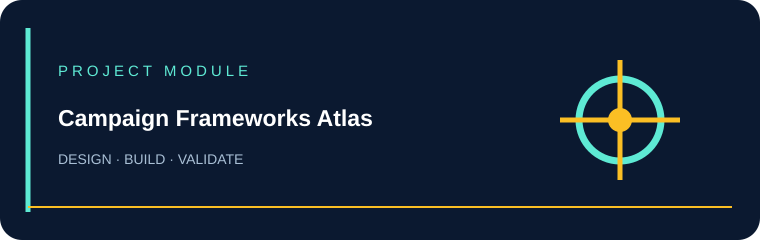

**INDEPENDENT ENGINEERING PORTFOLIO · CAMPAIGN FRAMEWORKS ATLAS**

[GitHub Profile](https://github.com/sghatge) · [Portfolio](https://sghatge.github.io/adobe-campaign-v8-governance/)

---

# Campaign Frameworks Atlas

Ten production patterns for **Adobe Campaign Classic v8**, each shown as a complete build sheet:

- Business case: problem, audience, outcome
- Real-time scenario timeline
- Solution architecture diagram (data in → Campaign v8 core → channels out, plus the AI layer)
- Workflow canvas as built in Campaign
- Simulated test run: trace sample records through the workflow, with test-group results
- Set-up steps, key set-up screen and a reference configuration (XML, JavaScript, SQL)
- Execution environment, AI roll-out with KPIs, risks and mitigations

| # | Framework | Area |
|---|---|---|
| 01 | Cross-channel cart abandonment with fallback routing | Revenue |
| 02 | Multi-market master–child campaign framework | Governance & scale |
| 03 | Instance health and operational monitoring | Reliability |
| 04 | Dynamic product recommendations via external API | Revenue |
| 05 | Fatigue management and global typology rules | Governance & scale |
| 06 | Zero-party data preference center | Data & privacy |
| 07 | Lead scoring and nurture lifecycle | Pipeline & insight |
| 08 | Voucher and promo code pool orchestration | Revenue |
| 09 | GDPR / CCPA automated purge pipeline | Data & privacy |
| 10 | Multi-touch attribution ETL connector | Pipeline & insight |

Link to a single framework with `#uc-1` … `#uc-10`.

## Campaign Ops Toolkit

[`/toolkit/`](https://sghatge.github.io/campaign-frameworks-atlas/toolkit/) has ten working tools, one per framework. Change the inputs and the results and generated configuration update as you type: cart recovery planner, pre-flight legal checker, health monitor thresholds, recommendation API capacity, pressure rule simulator, preference matrix builder, lead score calculator, voucher pool sizing, privacy request tracker and ETL volume estimator. Link to a tool with `#t-1` … `#t-10`.

> All test records, test-group results and KPI values are **simulated test data** for demonstration. They are not results from a live client. Code samples are reference patterns to adapt to each instance's schemas.

Static pages (`index.html`, `toolkit/index.html`), no build step. Fonts load from Google Fonts.

Prepared by Sangram G. · CRM & Marketing Ops architecture

<!-- GitHub Pages refresh: 2026-11-24 -->

---

## Portfolio, reproducibility & safe use

- [Sangram Ghatge — complete engineering portfolio](https://github.com/sghatge/sghatge)
- [OPSFORGE Build Lab](https://sghatge.streamlit.app/) — portfolio index only; this project is documented and maintained in its own repository.

**Reproducibility:** start with the setup and usage instructions in this README and the linked project documentation. Run the repository's available checks before changing behaviour; if no test command is documented, treat that as a validation task rather than assuming tests pass.

**Safe-use boundary:** this is an independent portfolio project. Use synthetic or sanitized examples. Do not treat sample configurations, assessments, checklists or simulated outputs as production approvals or connect the project to customer data or live enterprise systems without independent security, privacy, legal and operational review. Review dependencies, licences and secrets handling before deployment.
